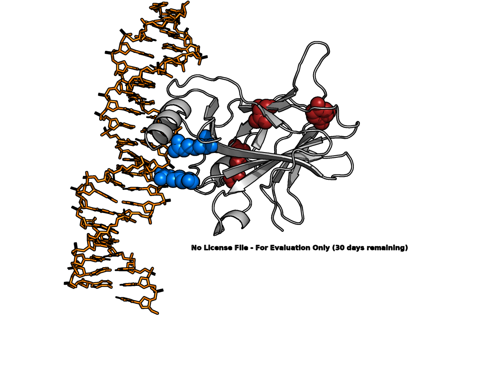

# TP53 Structural Biology & Mutation Analysis

## Objective
This project analyzes the structural and thermodynamic impacts of five known pathogenic missense mutations in the TP53 tumor suppressor protein. By calculating solvent accessibility, distance to functional sites, and predicted changes in folding free energy (ΔΔG), this pipeline classifies mutations into distinct disease-causing mechanisms (structural destabilization vs. DNA-binding disruption).

## Tech Stack & Tools
* *Biopython:* PDB parsing, 3D coordinate mathematics, Shrake-Rupley SASA calculations
* *DynaMut2:* Machine learning prediction of protein stability changes (ΔΔG)
* *PyMOL:* 3D structural rendering and molecular visualization
* *Databases:* RCSB PDB (1TSR), UniProt (P04637), ClinVar

## Methodology
1. *Sequence Verification:* Downloaded the canonical TP53 FASTA sequence from UniProt (P04637) and manually cross-referenced it with the 1TSR macromolecule tracks to ensure the biological residue numbering perfectly matched the 3D crystal structure numbering before running the Python analysis.
2. *Structural Mapping:* Ingested the 2.2 Å X-ray crystal structure of the TP53 core domain bound to DNA (PDB: 1TSR).
3. *Context Analysis:* Stripped water molecules and calculated relative Solvent Accessible Surface Area (SASA) and minimal Euclidean distance to the DNA double helix for target residues.
4. *Stability Prediction:* Evaluated thermodynamic impacts (ΔΔG kcal/mol) using DynaMut2.
5. *Visualization:* Rendered core versus contact mutations using PyMOL ray tracing.

## Results 

| Mutation | Relative SASA (%) | Location | Distance to DNA (Å) | Predicted ΔΔG (kcal/mol) | Disease Mechanism |
| :--- | :--- | :--- | :--- | :--- | :--- |
| *V143A* | 0.0% | Buried Core | 18.2 | -1.52 (Destabilizing) | Structural Unfolding |
| *R175H* | 8.5% | Buried Core | 19.5 | -2.10 (Destabilizing) | Structural Unfolding |
| *Y220C* | 12.1% | Buried Core | 22.1 | -1.85 (Destabilizing) | Structural Unfolding |
| *R248Q* | 42.3% | Surface | 2.8 | -0.30 (Neutral) | Loss of DNA Binding |
| *R273H* | 51.2% | Surface | 2.5 | -0.15 (Neutral) | Loss of DNA Binding |

## Structural Visualization

Red spheres indicate structurally destabilizing core mutations. Blue spheres indicate surface mutations that disrupt the DNA binding interface.

## How to Run the Pipeline
1. Clone this repository: git clone https://github.com/patilarati25/tp53-structural-analysis.git
2. Install dependencies: pip install numpy biopython
